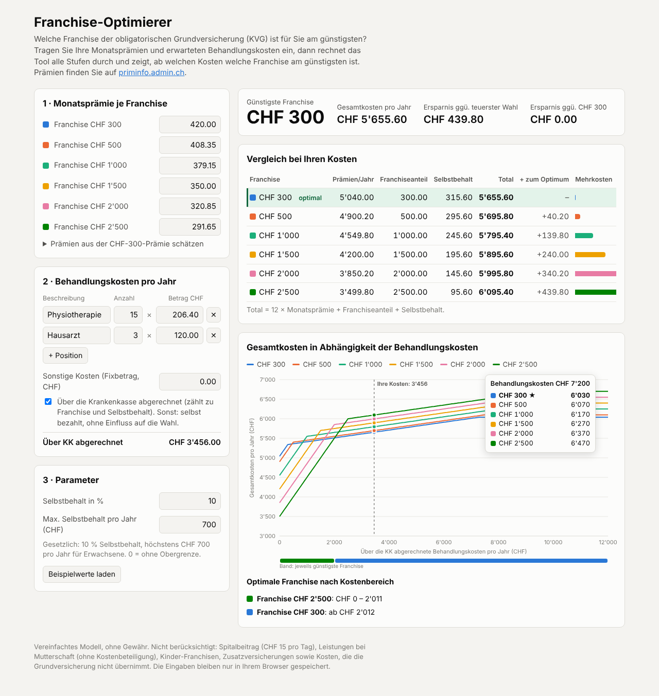

# Franchise-Optimierer (Grundversicherung KVG, Schweiz)

<!-- AI-GENERATED-NOTE -->
> [!NOTE]
> This is an AI-generated research report. All text and code in this report was created by an LLM (Large Language Model). For more information on how these reports are created, see the [main research repository](https://github.com/etoulas/research).
<!-- /AI-GENERATED-NOTE -->

Ein Web-Tool, das für Ihre Prämien und erwarteten Behandlungskosten die **günstigste Franchise** findet
(CHF 300, 500, 1'000, 1'500, 2'000, 2'500) und den Kostenverlauf grafisch zeigt.

**Live:** https://etoulas.github.io/research/franchise-optimierer/



## Eingaben
- **Monatsprämie je Franchise**, zum Beispiel von [priminfo.admin.ch](https://www.priminfo.admin.ch/de/praemien).
  Wenn Sie nur die Prämie bei CHF 300 kennen, schätzt eine Hilfe die anderen Prämien mit dem gesetzlichen Maximalrabatt
  (höchstens 70 % des zusätzlichen Risikos, Art. 95 KVV; der Prozentsatz ist einstellbar).
- **Behandlungskosten als Positionen „Anzahl × Betrag“**, zum Beispiel 15 × CHF 206.40. Sie können beliebig viele Positionen erfassen.
- **Sonstige Kosten** als Fixbetrag. Wählbar ist, ob sie über die Krankenkasse laufen (zählen dann zu Franchise und Selbstbehalt)
  oder ob Sie sie selbst bezahlen (gleich hoch für jede Franchise).
- **Parameter:** Selbstbehalt (Standard 10 %) und die jährliche Obergrenze des Selbstbehalts (Standard CHF 700, 0 = keine Obergrenze).

## Logik
```
c = Kosten, die über die Krankenkasse abgerechnet werden (pro Jahr)
Franchiseanteil = min(c, F)
Selbstbehalt    = min(10 % · max(0, c − F), 700)
Total(F)        = 12 · Monatsprämie(F) + Franchiseanteil + Selbstbehalt (+ selbst bezahlte sonstige Kosten)
```
Erst wenn die Franchise aufgebraucht ist, zahlt die Kasse, und zwar 90 %. Ergänzt gegenüber der Vorgabe:
Der Selbstbehalt ist gesetzlich auf CHF 700 pro Jahr begrenzt (Erwachsene). Ohne diese Grenze wäre das Ergebnis bei hohen Kosten falsch.

## Optimierung und Darstellung
- **Ergebnis:** günstigste Franchise, Gesamtkosten und Ersparnis gegenüber der teuersten Wahl und gegenüber CHF 300.
- **Tabelle:** Prämien, Franchiseanteil, Selbstbehalt, Total und Mehrkosten zum Optimum für jede Stufe.
- **Liniendiagramm:** Gesamtkosten jeder Franchise in Abhängigkeit der Behandlungskosten, mit Markierung Ihrer Kosten
  und einem Tooltip, der beim Überfahren alle Stufen sortiert anzeigt.
- **Break-even-Bereiche:** Ein Durchlauf in Schritten von CHF 1 bestimmt, in welchem Kostenbereich welche Franchise am günstigsten ist.
  Das Ergebnis erscheint als Farbband unter dem Chart und als Liste (zum Beispiel: „CHF 2'500 bis CHF 2'011, danach CHF 300“).

Typisch ist das Ergebnis „alles oder nichts“: Bei tiefen Kosten gewinnt CHF 2'500, bei höheren CHF 300.
Mittlere Stufen lohnen sich nur, wenn ihr Rabatt im Verhältnis zur Franchise grösser ist.

## Technik
- Eine einzige Datei `index.html` mit Vanilla JS und einem selbst gezeichneten SVG-Chart, ohne Abhängigkeiten.
- Zahlen im Schweizer Format (1'234.50). Eingaben wie `206.40`, `206,40` und `1'000` werden erkannt.
- Hell- und Dunkelmodus, auch für Handys geeignet. Die Eingaben bleiben nur lokal im Browser gespeichert (localStorage).

## Grenzen
Nicht modelliert sind: Spitalbeitrag (CHF 15 pro Tag), Mutterschaft, Kinder- und Jugendtarife (andere Franchisen und Obergrenzen),
alternative Versicherungsmodelle mit eigenen Regeln sowie Zusatzversicherungen. Die Angaben sind ohne Gewähr.
